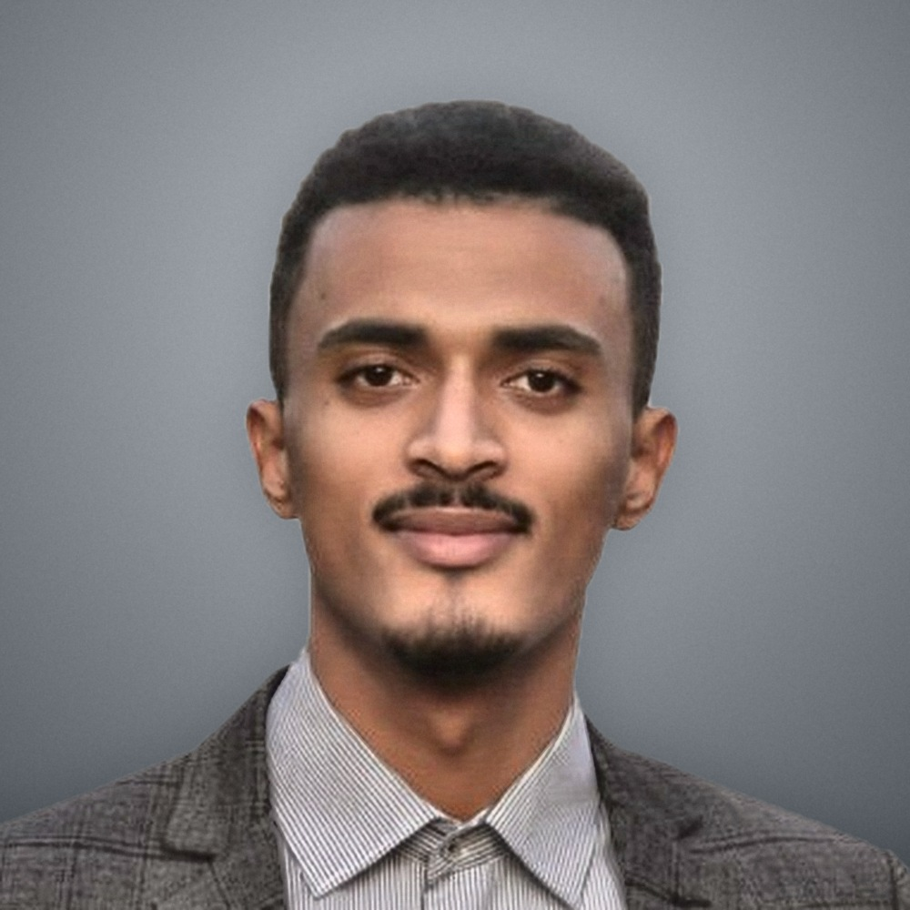

# Hi, I am Youness Abbida

**AWS security engineer** · **AWS Certified Security – Specialty** · **AWS Certified Solutions Architect – Associate**

Casablanca-Settat, Morocco · Open to remote and hybrid roles

---

## Navigate

- **About me (recruiters):** [ABOUT_ME.md](aws-cloud-security-portfolio/ABOUT_ME.md) — [view on GitHub](https://github.com/YounessAbbida/aws-cloud-security-portfolio/blob/main/aws-cloud-security-portfolio/ABOUT_ME.md)
- **AWS Security Labs Portfolio:** [Portfolio README](aws-cloud-security-portfolio/README.md) — [browse on GitHub](https://github.com/YounessAbbida/aws-cloud-security-portfolio/tree/main/aws-cloud-security-portfolio)
- **LinkedIn:** [youness-abbida-71916424a](https://www.linkedin.com/in/youness-abbida-71916424a)
- **GitHub profile:** [github.com/YounessAbbida](https://github.com/YounessAbbida)
- **Website:** [younessabbida.netlify.app](https://younessabbida.netlify.app)

## Featured projects

- **[aws-account-lockdown](https://github.com/YounessAbbida/aws-account-lockdown)** — audit-ready AWS security baseline as Terraform (CloudTrail, GuardDuty, Security Hub, Config, IAM clean-up)
- **[gha-ecs-oidc-demo](https://github.com/YounessAbbida/gha-ecs-oidc-demo)** — GitHub Actions to ECS Fargate with OIDC, no stored AWS keys
- **[gha-n8n-aws](https://github.com/YounessAbbida/gha-n8n-aws)** — self-hosted n8n on AWS with backups and no open SSH

---

## At a glance

- Enterprise **Microsoft 365**, **Entra ID**, **Defender**, **Windows Server** — global IT / aviation (Air Arabia)
- **AWS** security labs (IR, encryption, network security, Config) under **aws-cloud-security-portfolio/**
- Master in **security and automation of IT architectures and cloud computing** (ENSI)

---

## Repository layout

Labs, images, and **ABOUT_ME.md** are inside the **aws-cloud-security-portfolio** folder. Open that folder on GitHub if the root only shows one directory.

---
